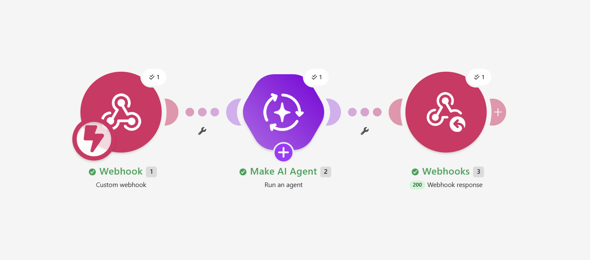

# Nombre del proyecto
Huella energética de la nube

## Descripción
La página registra ocho hábitos digitales y los envía a Make. Un agente de IA estima el consumo eléctrico asociado y devuelve al navegador una respuesta con sus supuestos, el impacto ambiental y tres acciones para reducirlo.

El proyecto distingue entre energía, expresada en kWh, y emisiones, expresadas en kg de CO₂e. Para estimar las emisiones se necesita un factor eléctrico con una fuente identificada.

## Objetivos de aprendizaje
- Reconocer qué hábitos digitales requieren energía en centros de datos y redes.
- Registrar actividades con las unidades de tiempo y uso correspondientes.
- Integrar un formulario web con un webhook y un agente de IA en Make.
- Revisar los supuestos de una estimación y discutir quién asume los costos ambientales.

## Material utilizado
- Computadora o celular con navegador y conexión a internet.
- HTML, CSS y JavaScript reunidos en un archivo, sin bibliotecas externas.
- Make con un webhook personalizado, Make AI Agent y Webhook response.
- GitHub para almacenar el código, la demostración y el informe.

## Diagrama del flujo
El formulario envía por POST los campos `video`, `musica`, `redes`, `videollamadas`, `juegos`, `nube`, `ia` y `correos`. El agente recibe los ocho valores y su respuesta de texto vuelve a la página con HTTP 200.

Formulario web → Webhook → Make AI Agent → Respuesta del webhook → Estimación en la página.

## Código
- [Calculadora web](c%C3%B3digo/index.html)
- [Blueprint del escenario de Make](c%C3%B3digo/Huella_Nube.blueprint.json)

Para utilizar el proyecto:

1. Descarga el HTML e importa el blueprint en Make.
2. Vincula un webhook y una conexión para el agente. Completa en sus instrucciones el factor de emisiones con su unidad, región, año y fuente, y activa el escenario.
3. Coloca la URL HTTPS de tu webhook en `WEBHOOK_URL` dentro de una copia privada del HTML.
4. Abre esa copia en el navegador, completa los ocho campos y pulsa **Calcular mi huella**. Puedes pulsar el título para cargar los datos de ejemplo.

La copia publicada deja el webhook del HTML vacío y el blueprint sin las conexiones originales. Si el navegador bloquea la respuesta desde otro origen, configura los permisos de origen en la respuesta de Make.

## Video del funcionamiento
[Ver demostración sin audio](video/Huella_nube_sin_audio.mp4)

## Imágenes
Captura de una ejecución del escenario en Make:

## Conclusiones
La demostración muestra que la página recibe y presenta la estimación del agente. Los valores sirven para discutir hábitos digitales. Para comparar actividades se necesitan factores documentados por hora, por evento o por GB y periodo, según corresponda.

El factor eléctrico queda pendiente en el blueprint. Por eso la demostración muestra valores en kWh, pero deja sin calcular las emisiones anuales.

## Resultados

[Reporte técnico y respuestas a las cinco preguntas (PDF)](resultados/Reporte_tecnico_huella_nube.pdf)
